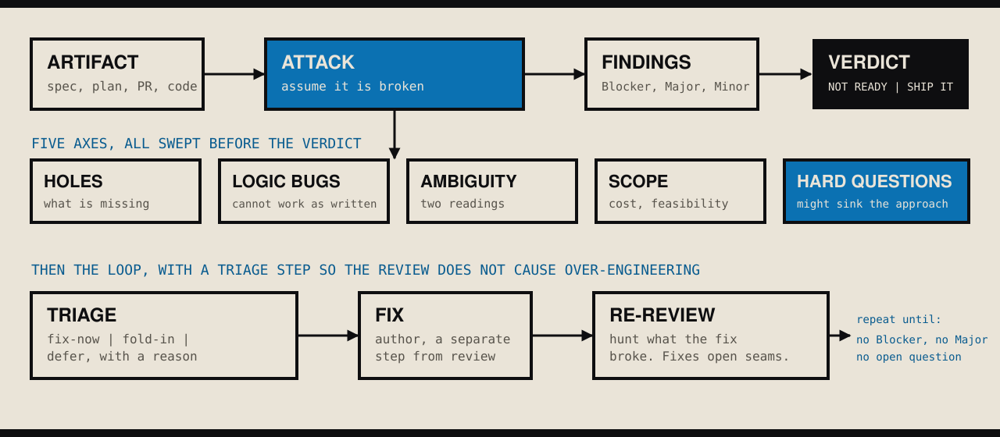
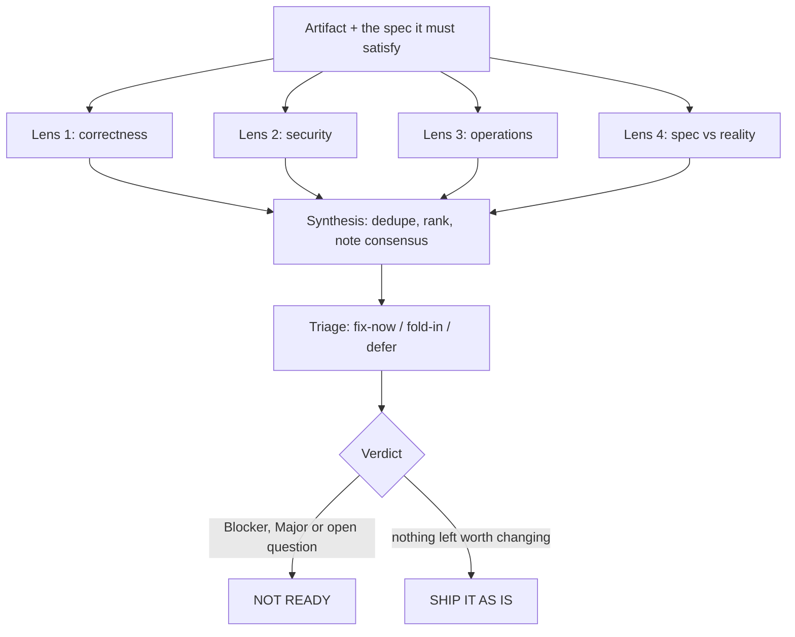

<p align="center">
  
</p>

> **A Claude Code skill that reviews your work like it is trying to get it killed in code review. Severity-ranked findings, the hard questions, and a binary verdict. NOT READY is the default.**

*Social preview line: Polite reviews ship bugs. This skill assumes your spec, plan or PR is broken, hunts across five axes, and refuses to say "looks good" until it has proof.*

---

## The problem

Most reviews are polite, and polite reviews ship bugs.

You ask "does this look good?" and get "great work! a few small suggestions". Then a contradiction you both missed costs three days downstream. A reviewer that is trying to like your work is not the reviewer you need before you ship.

## The concept

**The artifact is the target, never the author. The default assumption is that it is broken.**

- **Flattery is failure.** No "great work, but...". No "what's fine" section.
- **No filler either.** A genuinely clean pass says so and ships it. It will not invent problems to look thorough.
- **Proof or it is a question.** A Blocker or Major needs a failing test or a file and line you can check. Without proof it goes under Hard Questions.
- **Letter equals spirit.** "It's basically fine" is not a verdict.
- **A findings list is not a to-do list.** The review triages: fix-now, fold-in, or defer with a reason, so it does not cause the over-engineering it is meant to catch.
- **Fixes open new seams.** After a fix, it re-reviews and hunts exactly what the fix broke.

## How it works

<p align="center">
  
</p>

It attacks across five axes and sweeps all five before it gives a verdict:

| Axis | It asks |
|---|---|
| **Holes** | What is missing: unstated assumptions, unhandled cases, absent error and edge behaviour, no acceptance criteria |
| **Logic bugs** | Contradictions, ordering problems, races, steps that cannot work as written |
| **Ambiguity** | Anything a builder could read two ways. Each one is named |
| **Scope and feasibility** | Over-engineering, hidden cost, constraints that are not realistic |
| **Hard questions** | The uncomfortable ones whose answers might invalidate the whole approach |

It **grounds every claim**: it reads the referenced code, checks the cited line, confirms the API exists. "I checked, the function is actually named X" beats "this might be wrong".

### Solo or fan-out

- **Small or low-stakes:** one reviewer, five axes, one pass.
- **Large or high-stakes** (a spec, an architecture, a PR touching many files): N reviewers in parallel, each with ONE distinct lens (correctness, security, operations, spec versus reality, cost), blind to each other. A synthesis pass dedupes and ranks. When three independent lenses flag the same thing, that is no longer a hunch. Prompt templates: [`examples/fan-out-lenses.md`](examples/fan-out-lenses.md).



### Seed it to go deep

When facts are already verified, hand them to the reviewer up front: "these are confirmed, do NOT re-flag them, go deeper or find new ones". A pass that re-reports what you already knew was wasted.

## What it looks like

A full synthetic example, a review of a made-up password-reset spec, is in [`examples/sample-review.md`](examples/sample-review.md). The shape of every finding:

```markdown
- **Severity:** Blocker
- **What:** Reset tokens are stored in plain text, so a read-only database leak is an account takeover.
- **Where:** Step 4 (`reset_tokens.token`).
- **Proof:** Step 4 lists the stored column as `token`, the same value that step 1 puts in the emailed link.
- **Why it matters:** Anyone with read access to a backup can reset any account with a pending token.
- **Fix:** Store a SHA-256 hash of a 32-byte random token and compare in constant time.
```

Then the hard questions and exactly one verdict:

```markdown
### Hard Questions
1. Does the reset response reveal whether an account exists?
2. What is the support path when the user has lost the mailbox as well?

### Verdict
**NOT READY** - 2 Blockers and 2 Majors, and 3 open hard questions. Fixing the token storage
and the phone-only case will change the table and the flow, so re-review after the fix and
look for what the fix broke.
```

And the triage step, because six findings on a five-file PR is not six tasks ([`examples/triage-example.md`](examples/triage-example.md)):

| # | Finding | Decision |
|---|---|---|
| 1 | Race double-sends emails | fix-now |
| 2 | Unescaped user input in HTML | fix-now |
| 3, 5 | PII in error strings, unbounded history table | fold-in |
| 4, 6 | A full state machine for a rare hard-kill window, a new auth scheme | defer, with the reason written down |

## Install

```bash
git clone https://github.com/FuzulsFriend/adversarial-review
mkdir -p ~/.claude/skills
cp -r adversarial-review/skill ~/.claude/skills/adversarial-review
```

PowerShell:

```powershell
git clone https://github.com/FuzulsFriend/adversarial-review
Copy-Item -Recurse adversarial-review/skill $HOME\.claude\skills\adversarial-review
```

Anywhere else: paste [`skill/SKILL.md`](skill/SKILL.md) into your agent's system or skill context. It is one file; the `evals/` folder is optional.

## Use it

It fires on its own when you are about to lie to yourself:

- you are about to approve, merge, ship or finalise anything;
- you just finished a task and you are reaching for "good enough";
- someone asks "is this done?" or "any problems?";
- a first draft is about to become the final draft.

Or summon it: *"adversarial-review this"*, *"review this like you are trying to kill it"*.

## Inside a bigger loop

[claude-lead-loop](https://github.com/FuzulsFriend/claude-lead-loop) uses this skill's axes and output format for its review panels, with a different exit rule: every fresh reviewer starts from NOT READY, so "loop until SHIP IT" never ends. Inside a program the exit is: no PROVEN Blocker or Major, at most 2 attacker rounds, hard questions to the decisions list, and each serious code finding put to 2 refuters before anyone spends a fix round on it.

## What is in the box

| Path | What it is |
|---|---|
| [`skill/SKILL.md`](skill/SKILL.md) | The skill: frontmatter, the iron rule, five axes, solo versus fan-out, output format, severity definitions, the loop. |
| [`skill/evals/evals.json`](skill/evals/evals.json) | Three eval prompts with planted flaws (a spec with a contradiction, a plan with a use-after-delete, a triage question). |
| [`skill/evals/benchmark.md`](skill/evals/benchmark.md) | One head-to-head run against a plain review. |
| [`examples/sample-review.md`](examples/sample-review.md) | A full synthetic review. |
| [`examples/triage-example.md`](examples/triage-example.md) | The triage step on six findings. |
| [`examples/fan-out-lenses.md`](examples/fan-out-lenses.md) | Prompt templates for parallel lenses and the synthesis pass. |

## Receipts, and how far to trust them

The skill was run head-to-head against a plain "review this" on two deliberately flawed artifacts ([`benchmark.md`](skill/evals/benchmark.md)):

- It produced structured, severity-ranked findings while the plain review wrote prose.
- It surfaced an explicit Hard Questions list the plain review buried, and added no reassurance padding.
- It went deeper on one artifact: it caught a `/tmp` path bug on a plan that wrote to a fixed temp path, and a concurrent-run temp-file collision that the plain review missed.
- It found a formatting bug in its own output spec during testing (a doubled severity line), which was fixed.

Honest caveat: that is two artifacts with planted flaws, on an easy set. Recall was high in both arms (the planted flaws are fairly obvious), so the visible win is output discipline and depth, not raw catch rate. A larger, subtler test set would measure the rest.

## Field notes

- **Two skills disagreed.** An orchestration plan reviewed with this skill came back NOT READY, because "loop until SHIP IT" never ends when every fresh reviewer starts from NOT READY. That is why the loop section ends with an exit rule for use inside a larger program.
- **Reviewers always find something.** A reviewer asked to find problems will always find some, so review rounds never converge on their own. Triage and the proof requirement are what make this skill's output finite.
- **Refuter cost.** Sending every finding to two refuters spent most of a workflow on confirming Minors. Refuters are for Blockers and Majors in code reviews only; design reviews rely on the triage owner checking the cited lines.

## FAQ

**Will it ever say SHIP IT?**
Yes, when there are no Blockers, no Majors, no unanswered hard questions and the remaining Minors are not worth another revision. It will not on a first pass unless the artifact is genuinely airtight.

**Does it fix the artifact?**
No. A review pass reviews; fixing is a separate step, so the reviewer keeps no ego in the result.

**Is it harsh on people?**
It is harsh on the work. Be harsh on the work, kind to the people.

**How is this different from asking "review this"?**
Structure (severity, where, proof, why, fix), an enforced verdict, hard questions, no padding, a triage step, and a re-review that hunts for what the fix broke.

## More from the same author

- [claude-lead-loop](https://github.com/FuzulsFriend/claude-lead-loop): one session runs a multi-day engineering program; this skill is its review format.
- [claude-usage-limits](https://github.com/FuzulsFriend/claude-usage-limits): the session tracks its own limits and context window.

## Author

**Tomer Ezri, Adv.** Lawyer turned AI builder, Tel Aviv. I teach businesses to work with AI, and I teach what I actually build: I solo-built [MarkIt](https://mark-it.co), a live AI capture platform.

[GitHub](https://github.com/FuzulsFriend) / [tomerezri.vercel.app](https://tomerezri.vercel.app)

## License

MIT. See [LICENSE](LICENSE).
