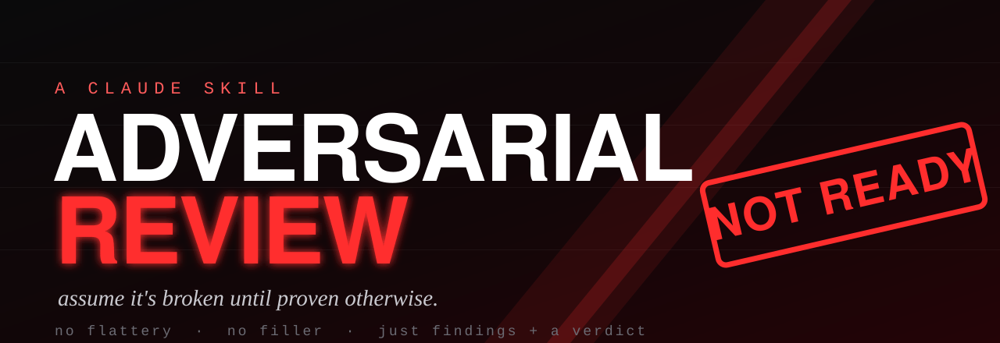

<p align="center">
  
</p>

<h1 align="center">Adversarial Review</h1>

<p align="center">
  <b>A Claude skill that reviews your work like it's trying to get it killed in code review.</b><br>
  No flattery. No "looks good to me." Just severity-ranked findings, the hard questions, and a binary verdict.
</p>

<p align="center">
  
  
  
  
</p>

---

## The problem

Most reviews are polite. Polite reviews ship bugs.

You ask "does this look good?" and your tools say "great work! a few small suggestions 🙂" - and then a contradiction you both missed costs three days downstream. The reviewer that's trying to like your work is not the reviewer you need before you ship.

## The fix

**Adversarial Review** flips the default. It assumes the artifact is **broken until proven otherwise** and goes hunting. It works on anything reviewable - a spec, a plan, a design, a PR, code, a config, a contract.

It attacks across five axes:

| | |
|---|---|
| **Holes** | missing cases, unstated assumptions, absent error/edge behavior |
| **Logic bugs** | contradictions, ordering bugs, races, wrong data flow |
| **Ambiguity** | anything a builder could read two ways |
| **Scope & feasibility** | over-engineering, hidden cost, things that will balloon |
| **Hard questions** | the uncomfortable ones whose answer might invalidate the whole approach |

Then it hands you findings ordered by severity (**Blocker / Major / Minor**, each with *what / where / why it matters / the fix*), a numbered **Hard Questions** list, and exactly one verdict:

> **NOT READY** &nbsp;·&nbsp; **SHIP IT AS IS**

And it will not say SHIP IT on the first pass unless the thing is genuinely airtight. Most first passes don't make it.

## Scales with the stakes

Small artifact? One pass, five axes. Big or high-stakes one - a spec, an architecture, a multi-file PR? Fan it out into **parallel single-lens reviewers** (correctness, security, ops, spec-vs-reality), each blind to the others, then synthesize. When three independent lenses flag the same thing, that's not a hunch anymore.

## Receipts

Run head-to-head against a plain review on two deliberately-flawed artifacts:

- It produced **structured, severity-ranked** findings while the plain review wrote a wall of prose.
- It surfaced an explicit **Hard Questions** list the plain review buried.
- It refused to pad with reassurance ("what's fine" sections - gone).
- It went **deeper**: it caught a `/tmp` path bug on a **Windows** project and a **concurrent-run temp-file collision** that the plain review missed entirely.

It even found a formatting bug in *its own* output spec during testing, and that got fixed. The reviewer reviews itself.

## Install

**Claude Code** - drop the skill where Claude looks for skills:

```bash
git clone https://github.com/FuzulsFriend/adversarial-review
mkdir -p ~/.claude/skills/adversarial-review
cp adversarial-review/SKILL.md ~/.claude/skills/adversarial-review/
```

Then just work. It fires on its own when you're about to sign off on something - or summon it: *"adversarial-review this."*

**Anywhere else** - paste [`SKILL.md`](SKILL.md) into your agent's system/skill context. It's one file.

## It fires when you're about to lie to yourself

- You're about to approve / merge / ship / finalize anything.
- You just finished a task and you're reaching for "good enough."
- Someone asks "is this done?"
- A first draft is about to become the final draft.

## The rules it won't break

- **Flattery is failure.** The artifact is the target, never the author.
- **No manufactured filler.** A clean pass says so and ships it - it won't invent issues to look busy.
- **A findings list is not a to-do list.** It triages - fix-now, fold-in, defer-and-document - so the review doesn't *cause* the over-engineering it's meant to catch.
- **Fixes create new seams.** After a fix, it re-reviews and hunts exactly what the fix broke.
- **Letter = spirit.** "It's basically fine" is not a verdict.

## Sample verdict

```
## Verdict
NOT READY - 2 Blockers and 6 Majors. Closing the loop the right way
introduced a split-control-plane; the budget cap now sits on the wrong
side of the boundary. Fix the run-gate handshake and most of these
collapse together. Re-review after - the fix will open new seams.
```

That's a real one. It's how this README's sibling project survived four review passes before anyone wrote a line of code.

---

<p align="center"><sub>MIT licensed. Built with Claude. Be harsh on the work, kind to the people.</sub></p>
